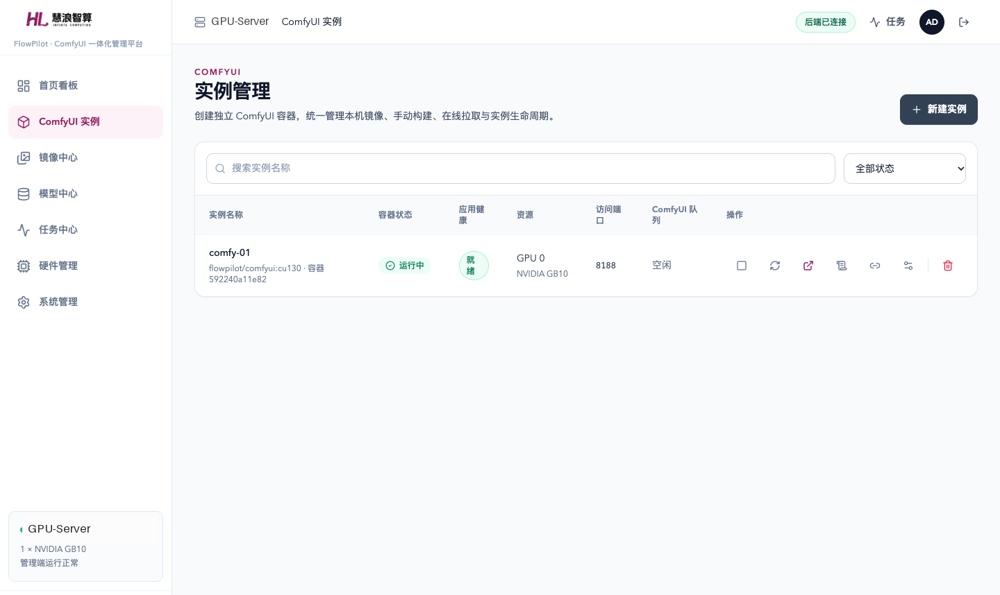
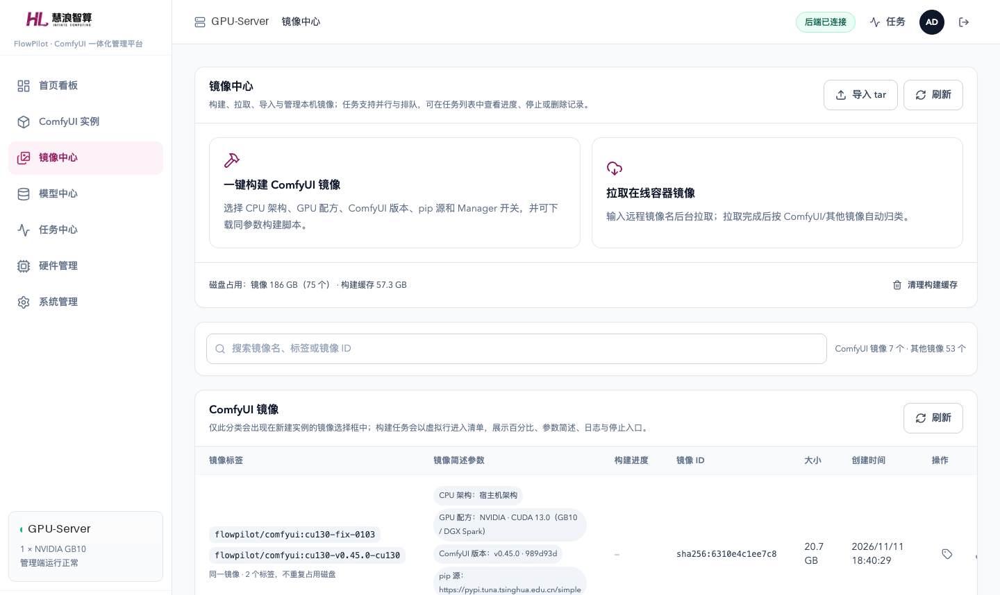
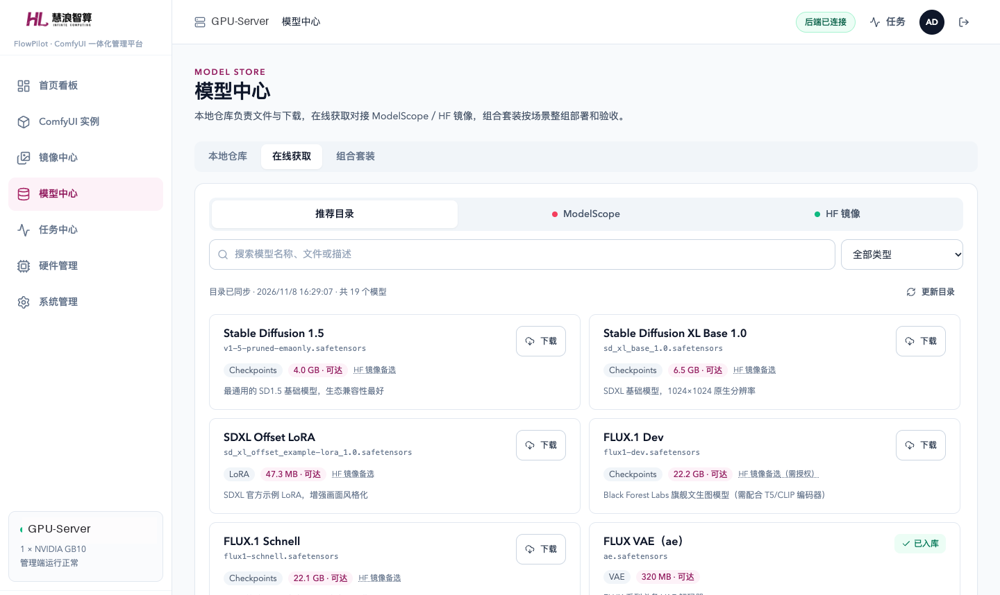
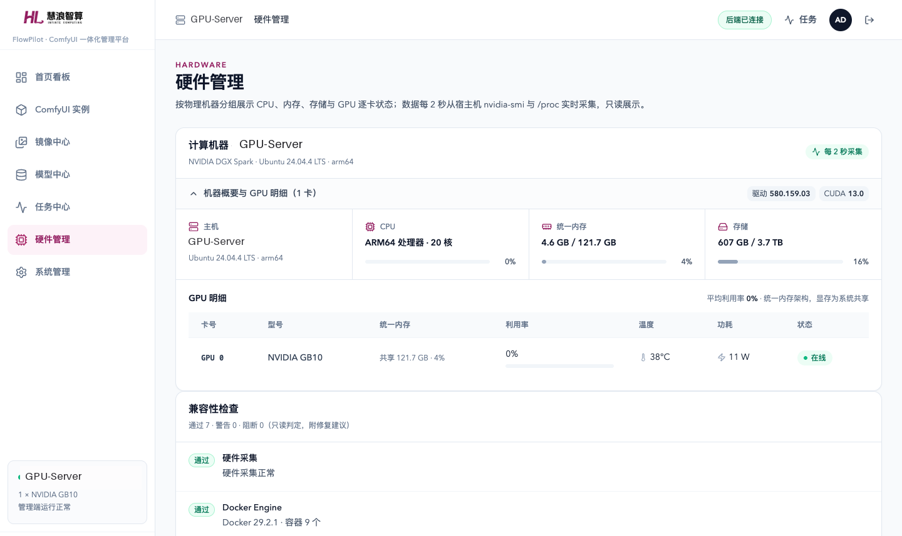

# 慧浪智算 · FlowPilot

**面向 GPU 物理服务器的轻量化 ComfyUI 部署与管理平台。**

把 ComfyUI 实例、镜像、模型、任务和硬件状态集中到一个 Web 控制台。管理服务原生运行，ComfyUI 实例通过 Docker 隔离，支持 Linux AMD64 与 ARM64。

[下载最新版](https://github.com/ghoul02015/flowpilot/releases/latest) · [中文安装手册](docs/deployment/README.zh-CN.md) · [English Guide](docs/deployment/README.en.md)

## 为什么选择 FlowPilot

- **安装更简单**：一个脚本自动识别 CPU 架构，提供环境检查、国内镜像回退、后台安装和中断续装。
- **实例管理更集中**：创建、启动、停止、重建和删除 ComfyUI 实例，查看 GPU 分配、队列、实时日志与工作区。
- **镜像管理更清晰**：在线拉取、本地导入和一键构建 ComfyUI 镜像，固定版本与源码提交，构建过程可追踪。
- **模型使用更高效**：统一管理共享模型库，支持 URL 下载、本地导入、ModelScope／HF 镜像在线获取和模型组合套装。
- **任务与数据更可靠**：统一查看下载、导入、构建和备份任务，支持断点续传、SHA256 校验、数据隔离与平台备份。
- **硬件状态更直观**：实时查看 CPU、内存、存储、GPU、驱动与 CUDA 信息，并提供兼容性检查。

## 产品界面

| ComfyUI 实例管理 | 镜像中心 |
| --- | --- |
| 集中管理实例生命周期、GPU、端口、队列和日志。 | 构建、拉取、导入并管理本机镜像。 |
|  |  |

| 模型中心 | 硬件管理 |
| --- | --- |
| 在线获取、下载和共享模型，减少重复存储。 | 实时掌握 GPU 与宿主机资源状态。 |
|  |  |

## 快速安装

### 环境要求

- Linux 服务器，使用 systemd，CPU 架构为 AMD64 或 ARM64。
- 已安装并启动 Docker Engine。
- 需要 GPU 实例时，预先配置 NVIDIA 驱动与 NVIDIA Container Toolkit。
- 安装器只检测基础环境，不安装或修改 Docker、NVIDIA 驱动、CUDA 与 NVIDIA Container Toolkit。

### 一键部署

```bash
curl -fL --retry 3 -o flowpilot-native.sh \
  https://github.com/ghoul02015/flowpilot/releases/latest/download/flowpilot-native.sh
chmod +x flowpilot-native.sh

# 交互式安装；国内网络可增加 --region cn
sudo ./flowpilot-native.sh install
```

安装完成后访问 `http://<服务器地址>:18080`，使用账号 `admin` 和安装时设置的密码登录。

```bash
# 中断后续装
sudo ./flowpilot-native.sh resume

# 查看安装状态
sudo ./flowpilot-native.sh status

# 默认卸载，保留业务数据
sudo flowpilot-native uninstall
```

离线包、无人值守安装、后台运行、目录说明、彻底卸载与故障排查，请参阅[中文安装手册](docs/deployment/README.zh-CN.md)。

## 适用场景

- 在 DGX Spark、GPU 工作站或物理服务器上交付 ComfyUI 环境。
- 为团队统一管理多套 ComfyUI 实例、镜像与共享模型。
- 在国内网络环境中完成可控、可恢复的安装与模型下载。
- 需要保留实例数据、操作审计和平台备份能力的私有化部署。

## 文档与下载

- [正式版本与双架构安装包](https://github.com/ghoul02015/flowpilot/releases)
- [中文产品说明与安装使用手册](docs/deployment/README.zh-CN.md)
- [English Product Overview and Installation Guide](docs/deployment/README.en.md)
- [版本更新日志](CHANGELOG.md)
- [贡献指南](CONTRIBUTING.md) · [安全策略](SECURITY.md)

## 安全与许可

FlowPilot 默认提供管理员认证、会话校验和操作审计，但不内置 TLS。请仅在受信任的管理网络中使用，或自行配置 HTTPS 反向代理，不要直接暴露到不受信任的公网。

项目采用 [Apache License 2.0](LICENSE)。模型、工作流及第三方组件可能适用各自独立许可，使用前请确认对应条款。

---

**FlowPilot is a lightweight, self-hosted platform for deploying and managing ComfyUI on GPU servers.** It provides native installation, Docker-based instance isolation, image and model management, background tasks, hardware monitoring, and bilingual deployment guides.
